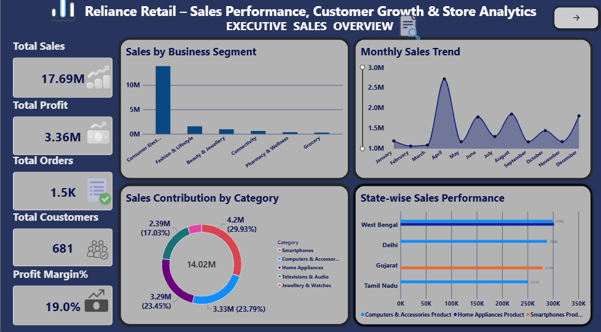
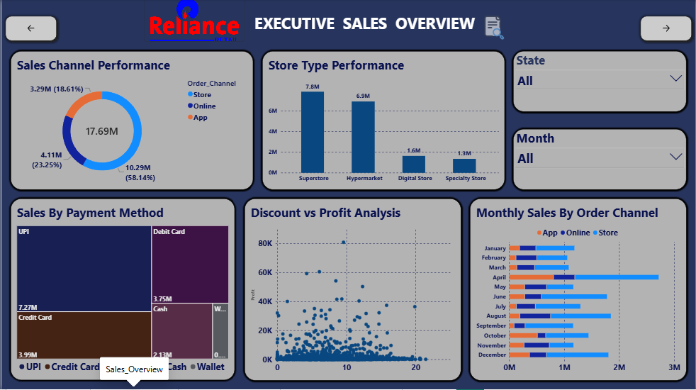
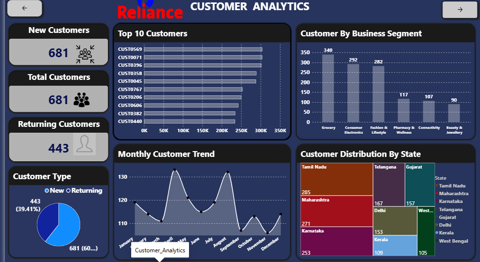
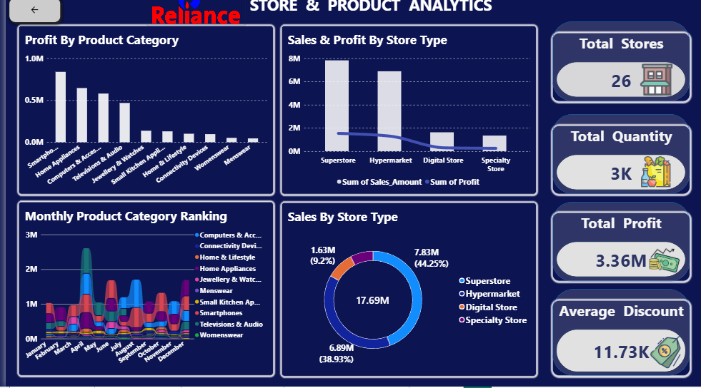

# Reliance Retail – Sales Performance, Customer Growth & Store Analytics

## 1. Project Information

- **Project Title:** Reliance Retail – Sales Performance, Customer Growth & Store Analytics
- **Industry Name:** Retail Analytics
- **Problem Statement:** Retail businesses need a clear way to review sales, profitability, customer activity, product categories, and store performance. This project uses an educational retail dataset and interactive Power BI dashboards to explore these areas and make the information easier to interpret.
- **Project Objectives:**
  - Review overall sales, profit, order, and customer KPIs.
  - Explore monthly sales trends across 2025.
  - Compare sales by business segment, product category, state, sales channel, store type, and payment method.
  - Explore customer types, returning customers, top customers, and customer trends.
  - Compare store and product-category performance.
  - Examine the relationship between discounts and profit.
- **Proposed Solution / Business Questions:** Use MySQL to store and retrieve the dataset, then use Power BI to explore questions such as: How do sales change by month? Which business segments and categories contribute to sales? How do results vary by state and store type? What customer trends are visible? How do discounts relate to profit?
- **Dataset Name:** Reliance Retail Sales Dataset – 1,500 Rows, 25 Columns
- **Dataset Source:** Synthetic dataset prepared for this educational project; it is not an official Reliance Retail dataset.
- **Database Name:** `reliance_retail1`
- **Table Name:** `reliance_retail_final_1500rows_25columns`
- **Dataset Period:** January–December 2025

## 2. Tools & Technologies

- **MySQL / SQL:** Database creation and dataset retrieval.
- **Power BI Desktop:** Dashboard development and data visualization.
- **Power Query:** Data preparation and transformation in Power BI.
- **DAX:** KPI measures and calculations in Power BI.
- **CSV:** Dataset format used for the retail data, where applicable to the local project files.

## 3. Project Overview

This project focuses on retail sales and business performance analysis. A synthetic dataset containing 1,500 rows and 25 columns for January–December 2025 is stored and retrieved through MySQL and analyzed in Power BI. Power Query is used for data preparation, and DAX measures support KPI reporting. Three report pages present executive sales performance, customer analytics, and store and product analytics. The intended business value is to make trends and comparisons easier to explore; the findings are illustrative because the dataset is synthetic.

## 4. Project Objectives

1. Summarize sales, profit, order, customer, and profit-margin metrics.
2. Analyze monthly sales patterns.
3. Compare sales across business segments, categories, states, channels, store types, and payment methods.
4. Explore customer distribution, returning-customer activity, and customer trends.
5. Compare store-type and product-category performance.
6. Explore discount and profit patterns using visual analysis.

## 5. Dataset Information

- **Rows:** 1,500
- **Columns:** 25
- **Period:** January–December 2025
- **Source type:** Synthetic educational dataset

Important columns include:

- Transaction_ID: Unique transaction reference
- Date: Transaction date
- Store_ID: Store identifier
- Customer_ID: Customer identifier
- Product_ID: Product identifier
- Category: Product category
- Quantity: Quantity sold
- Sales_Amount: Sales value
- Profit: Profit value
- Customer_Type: Customer classification
- Business_Segment: Business segment
- Month: Month associated with the transaction
- State: State associated with the transaction
- City: City associated with the transaction
- Discount_Percent: Discount percentage
- Store_Type: Store classification
- Order_Channel: Order channel
- Payment_Method: Payment method

Dataset Description

The dataset contains retail transaction details related to sales, customers, products, stores, discounts, business segments, locations, and payment methods. These fields help analyze different aspects of retail business performance.

## 6. Project Workflow

**Industry Selection → Problem Identification → Dataset Collection → MySQL Database Setup → Data Preparation and Transformation → Power BI Data Preparation and Modeling → KPI Development → Dashboard Development → Insights and Recommendations**

The workflow reflects the work performed in this project. SQL was used for database setup and data retrieval; advanced SQL cleaning and analysis scripts were not saved as separate project files.

## 7. SQL Analysis

The dataset was stored in MySQL and retrieved for use in Power BI.

### Database Setup

```sql
CREATE DATABASE reliance_retail1;
```

### Select the Project Database and Retrieve the Dataset

```sql
USE reliance_retail1;

SELECT *
FROM reliance_retail_final_1500rows_25columns;
```

The `CREATE DATABASE` statement creates the project database. The `USE` statement selects it, and the `SELECT` query retrieves all columns and records from the dataset table. SQL usage in this project focused on database setup and retrieval rather than advanced SQL analysis.

## 8. Power BI Dashboards

### Dashboard 1: Executive Sales Overview

**KPIs shown:**
- Total Sales: approximately 17.69 million
- Total Profit: approximately 3.36 million
- Total Orders: approximately 1.5K
- Total Customers: 681
- Profit Margin: approximately 19.0%

**Visuals included:**
- Sales by Business Segment
- Monthly Sales Trend
- Sales Contribution by Category
- State-wise Sales
- Sales Channel Performance
- Store Type Performance
- Sales by Payment Method
- Discount vs. Profit
- Monthly Sales by Order Channel

### Dashboard 2: Customer Analytics

**Metrics and visuals included:**
- Total Customers
- New Customers
- Returning Customers
- Customer Type Distribution
- Top 10 Customers
- Customers by Business Segment
- Monthly Customer Trend
- Customer Distribution by State

### Dashboard 3: Store & Product Analytics

**Metrics and visuals included:**
- Total Stores: 26
- Total Quantity: approximately 3K
- Total Profit
- Average Discount
- Profit by Product Category
- Sales and Profit by Store Type
- Monthly Product Category Ranking
- Sales by Store Type

Power Query was used for data preparation, and DAX measures were used for KPI calculations. State and month slicers were included where shown in the report. Month sorting was prepared for chronological monthly analysis.

## 9. Data Analysis & Visualization

The Power BI report covers:

- **KPI Analysis:** Summary of sales, profit, orders, customers, stores, and other displayed metrics.
- **Trend Analysis:** Monthly sales and customer trends.
- **Category-wise Analysis:** Sales and profit comparisons across product categories and business segments.
- **Performance Analysis:** Store-type, sales-channel, and payment-method comparisons.
- **Distribution Analysis:** Customer and sales distribution across states and customer types.
- **Relationship Analysis:** Visual exploration of discount versus profit.

## 10. Key Business Insights

The dashboard metrics and visualizations support the following areas of analysis:

- **Sales performance:** The Executive Sales Overview reports approximately **17.69 million** in total sales. The sales-channel visual helps compare the contribution of the available order channels.
- **Profitability:** Total profit is approximately **3.36 million**, with a displayed profit margin of approximately **19.0%**. These metrics provide a high-level view of profitability in the dataset.
- **Customer activity:** The Customer Analytics dashboard provides views of customer types, returning customers, top customers, and monthly customer trends. These visuals help explore customer activity and how it changes over time.
- **Business segments:** Segment-level visuals help compare the contribution of different business segments to sales and identify differences between segments.
- **Store performance:** Store and product visuals support comparisons between store types and product categories. The Store & Product Analytics dashboard also displays **26 stores** and approximately **3K total quantity**.
- **Discount analysis:** The **Discount vs. Profit** visual helps explore how discounts relate to profitability in the dataset. The chart supports exploration but does not by itself establish that discounts cause profit to increase or decrease.
- **Geographical analysis:** State-wise visuals help examine differences in sales and customer distribution across states.
- **Sales trends and payment methods:** Monthly trend, monthly sales by order channel, and payment-method visuals make it possible to compare sales patterns across months, channels, and payment methods.

## 11. Power BI Dashboard Screenshots


### Executive Sales Overview








### Customer Analytics





### Store & Product Analytics





## 12. Project Folder Structure

```text
Reliance_retail/
│
├── README.md
│
├── Dataset/
│   ├── Reliance Retail Cleaned Dataset.csv
│   └── Reliance_Retail_FINAL_Raw_Dataset_Backup.csv
│
├── SQL/
│   └── Reliance_retail.sql
│
├── PowerBI/
│   └── Reliance Retail.pbix
│
├── Screenshot/
│   ├── Executive_Sales_Overview1.png
│   ├── Executive_Sales_Overview2.png
│   ├── Customer_Analytics.png
│   └── Store&Product_Analytics.png
│
└── Documentation/
    ├── Reliance_Retail_Presentation.pdf
    
```
## 13. Conclusion

This project demonstrates a retail analytics workflow using MySQL and Power BI. MySQL is used to create the database and retrieve the dataset, while Power Query, DAX, and Power BI visuals support data preparation, KPI reporting, and analysis across executive sales, customer, store, and product perspectives. The project provides practice in SQL data retrieval and interactive dashboard development.

## 14. Author

- **Name:** Cathrine J
- **Student ID:** AF05331706
- **Organization:** Anudip Foundation
- **Course:** DBA_AI
- **Batch Code:** ANP-D7635
